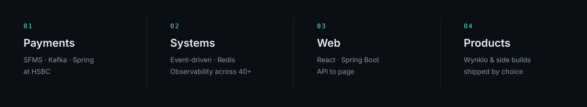
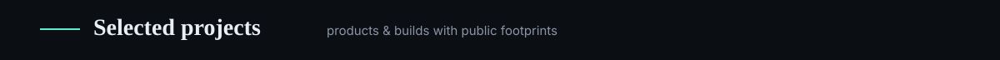

<!--
  Visual system (expressed in SVG assets):
  --ink: #0B0F14 | --slate: #121821 | --mist: #8B95A5
  --paper: #E9EEF5 | --signal: #5EEAD4 | --warm: #E8C07A

  Achievement counts are taken from the portfolio README, LinkedIn, and public GitHub.
  Confirm or replace any figure marked with [confirm] in the PR notes before treating as final.
-->

  

  <a href="https://pulkit-portfolio-lemon.vercel.app/"><strong>Portfolio</strong></a>
  &nbsp;·&nbsp;
  <a href="https://www.linkedin.com/in/pulkit-giddu/"><strong>LinkedIn</strong></a>
  &nbsp;·&nbsp;
  <a href="mailto:pulkitgiddu09@gmail.com"><strong>Email</strong></a>
  &nbsp;·&nbsp;
  <a href="https://leetcode.com/u/PulkitGiddu/"><strong>LeetCode</strong></a>

  

  

 

### Focus

  

At **HSBC** (Jul 2024 — present), I build distributed payment services with Java, Spring Boot, and event-driven architecture — including RBI SFMS integration, regulatory validation, and an observability dashboard across 40+ environments.

Outside work: shipping **Wynklo**, with Bookit, SnatchMart, and Bet2Learn alongside.

 

### Work achievements

<!-- Stats row inspired by portfolio-card layouts (structure only — ink/mint palette retained). -->

  
  
  

  Sources: LinkedIn experience · portfolio / HSBC write-up · same portfolio impact line. Replace any figure that needs a fresher count.

 

### Selected projects

  

<!-- Tight card row (no blank lines) so GitHub keeps three across, Avi-style. -->

| Project | What it is | Link |
| :--- | :--- | :--- |
| **Wynklo** | Product / digital builds I'm shipping now | [wynklo.com](https://www.wynklo.com/) |
| **Bookit** | Booking side product | [Book-IT](https://github.com/PulkitGiddu/Book-IT) |
| **AadhaarConnect** | Identity-connect build | [AadhaarConnect](https://github.com/PulkitGiddu/AadhaarConnect) |
| **VEat** | College canteen ordering (Java) | [VEat](https://github.com/PulkitGiddu/VEat) |
| **SnatchMart** | Commerce side product (via Wynklo) | [Wynklo](https://www.wynklo.com/) · *repo TBD* |
| **Bet2Learn** | Learning side product (via Wynklo) | [Wynklo](https://www.wynklo.com/) · *repo TBD* |
| **spyprice** | Product deal comparison | [spyprice](https://github.com/PulkitGiddu/spyprice) |
| **Portfolio** | Personal site (React + Java) | [live](https://pulkit-portfolio-lemon.vercel.app/) · [frontend](https://github.com/PulkitGiddu/portfolio-frontend) · [backend](https://github.com/PulkitGiddu/portfolio-backend) |

 

### Stack

  

  Java · Spring Boot · Kafka · Redis · PostgreSQL / Oracle · React · Node · AWS · Docker · Kubernetes

 

### Selected signals

| | |
| :--- | :--- |
| **HSBC** | Software Engineer — payments, reliability, quarterly releases |
| **Marks** | Winner, CodeFury 2024 · Top 3, Hack The Winter 2026 · 350+ LeetCode |
| **School** | B.Tech, Electronics & Telecommunication — VIT Pune (CGPA 8.03) |

 

### Activity

  
  

  

  <a href="https://pulkit-portfolio-lemon.vercel.app/">Visit portfolio</a>
  &nbsp;·&nbsp;
  <a href="mailto:pulkitgiddu09@gmail.com">Book time via email</a>
  &nbsp;·&nbsp;
  <a href="https://www.linkedin.com/in/pulkit-giddu/">Connect on LinkedIn</a>

