<!--
  Every card is an animated SVG from scripts/render_readme_cards.py, refreshed
  daily by .github/workflows/update-profile-art.yml.

  Brand: Night Ledger — obsidian (#090B10 / #12161E) + copper rail (#C9956C).
  Technique: SVG via , inline CSS keyframes + SMIL, subset WOFF fonts as
  base64, calm staggered entrance + hero rail pulse, prefers-reduced-motion off,
  STATIC=1 for screenshottable end state.

  Spacing is baked into the SVGs — keep rows free of blank lines between sibling
   tags so GitHub keeps three-across layouts tight.
-->

 
 
 
 
<picture><source media="(prefers-color-scheme: dark)" srcset="./cards/title-building-dark.svg" /></picture> 
 
<picture><source media="(prefers-color-scheme: dark)" srcset="./cards/title-built-dark.svg" /></picture> 

<a href="https://pulkit-portfolio-lemon.vercel.app/">portfolio</a>
&nbsp;/&nbsp;
<a href="https://www.linkedin.com/in/pulkit-giddu/">linkedin</a>
&nbsp;/&nbsp;
<a href="mailto:pulkitgiddu09@gmail.com">email</a>
&nbsp;/&nbsp;
<a href="https://leetcode.com/u/PulkitGiddu/">leetcode</a>
&nbsp;/&nbsp;
<a href="https://www.wynklo.com/">wynklo</a>
&nbsp;/&nbsp;
<a href="https://www.clubmates.in/">clubmates</a>

